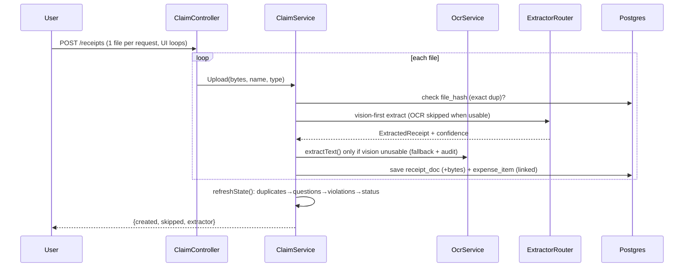

# Expense & Reimbursement Agent — Technical Design Document
### AI Innovation Lab Season 2 — Track 1: Expense & Reimbursement Agent (Spring Boot)

## 1. Project overview

**Problem (from business case):** Employees waste time collecting bills, entering details, categorising, checking allowability and preparing claims. HR/finance sees incomplete claims, duplicates and policy breaches.

**Solution:** AI-native chat assistant at `http://localhost:8081/`:
Drop photographs / PDFs / `.txt` bills → system OCRs → extracts vendor/date/amount/category → groups into a claim → asks *only* necessary questions → checks mock policy rules → flags duplicates → produces `READY → SUBMITTED (mock finance ref `MOCK-XXXXXXXX`)`.

**Track selected:** Complete experience, backend-heavy (per brief: “free to simulate or mock the other”). Finance/HR system is mocked (`Claim.submit()` generates deterministic reference, no real integration). Frontend is intentionally single-JAR static chat (no separate deploy) for fastest demo.

**Non-goals:** real SAP/Concur integration, payments, multi-currency FX, mobile native app.

## 2. User experience (fastest path)

1. New claim: `{employeeId, title}` → `DRAFT`.
2. Upload N files (`POST /api/claims/{id}/receipts`, multipart). Exact-byte duplicates skipped immediately.
3. Claim view shows: total, table, `questions[]`, `violations[]`, `status`.
4. Answer questions inline (`POST /items/{itemId}/answers {field, value}`).
5. `POST /submit` succeeds only when `questions==[]` and no `blocking` violations → status `SUBMITTED`.

Status machine: `DRAFT (empty) → NEEDS_INFO (missing/blocking) → READY (clean) → SUBMITTED → APPROVED / REJECTED` (review terminal, finance console at `/review.html`).

## 3. System architecture

### 3.1 Component diagram

```mermaid
flowchart LR
  UI[3-page UI<br/>upload + submit + finance] -->|REST multipart+JSON| API[ClaimController<br/>/api/claims]
  API --> SVC[ClaimService<br/>orchestration]
  SVC --> OCR[OcrService<br/>PDFBox + tesseract, vision-first skip]
  SVC --> EXT[ExtractorRouter<br/>gemini | glmocr]
  EXT --> G[GeminiExtractor<br/>cloud vision JSON]
  EXT --> M[GlmOcrExtractor<br/>transcribe → rules structure]
  EXT --> R[RuleBasedExtractor<br/>gap-filler, never a route]
  SVC --> DUP[DuplicateDetector<br/>fuzzy vendor+date+amount]
  SVC --> POL[PolicyEngine<br/>mock rules]
  SVC --> Q[CompletenessService<br/>necessary questions]
  SVC --> DB[(Postgres / H2<br/>claims, expense_items, receipt_docs)]
  SVC -->|mock ref| FIN[(Mock Finance<br/>approve/reject)]
```

### 3.2 Receipt pipeline (backend challenge)



### 3.3 Data model

- `claims(id UUID, employee_id, title, status, currency, created_at, updated_at, submitted_at, mock_reference, reject_reason, reviewed_at)`
- `expense_items(id, claim_id→claims, vendor, expense_date, amount, currency, category, description, source_file, confidence, needs_review, duplicate_of, receipt_id→receipt_docs, created_at)`
- `receipt_docs(id, claim_id→claims, file_name, content_type, file_hash SHA-256, ocr_text, content BYTEA, created_at)` + unique `(claim_id, file_hash)`.

JPA entities in `domain/`; Flyway `V1..V3` use portable `TIMESTAMP` + `CURRENT_TIMESTAMP` so H2 tests and Postgres prod share migrations.

## 4. AI / intelligence design (no paid key required)

| Concern | Implementation | Free alternate |
|---|---|---|
| Structured extract | `ReceiptExtractor` interface + `ExtractorRouter(provider=auto/gemini/glmocr)`; `glmocr` = GLM-OCR 0.9B transcribes, then structures as JSON (no regex anywhere); `gemini` = cloud vision JSON noise, and runs document-level validation (`tryRestoreDecimal`: dropped-dot totals reconciled against subtotal+tax, e.g. 192150 → 1921.50). `glmocr` = GLM-OCR 0.9B transcription → rule structuring (best accuracy, no hallucinated totals). Ollama vision sends downscaled (≤1024px) image bytes + grand-total prompt | Default `rule` (regex + keywords + arithmetic, 0 deps). Offline GPU: `qwen2.5vl:3b` via compose `vision` profile (RTX 2050-class, fits 4GB VRAM). `gemini-3.8-flash` free tier with vision (`inline_data`) via `GEMINI_API_KEY` |
|---|---|---|
| OCR | `OcrService`: PDFBox for PDFs; images go through receipt-tuned tesseract (real file suffix, 2x upscale of small phone photos, LSTM `--oem 1`, block mode `--psm 6`); `.txt` passthrough for demo/tests | `apt install tesseract-ocr` in Dockerfile; works without it |
| Categorise | Keyword vote: Food/Travel/Stay/Office/Medical/Entertainment | Deterministic, testable |
| Duplicates | Exact SHA-256 + fuzzy: `norm(vendor)` Levenshtein≤2 + same date + amount within 1% (floor 1.00) | Local, no embeddings API |
| Policy | `PolicyEngine`: total limit, receipt-required-above, 90-day freshness (warning), future-date (blocking), entertainment→warning, duplicate→warning | Config via `app.policy.*` env |
| Completeness | `CompletenessService`: one question per missing field + confirm prompt for low-confidence amounts (<0.6) | Chat UI renders these |

`extractWithFallback()`: if LLM returns empty/unusable, rule result is used (marked `+rule-fallback`) so pipeline never blocks.

## 5. API reference

| Method | Path | Notes |
|---|---|---|
| `GET` | `/healthz`, `/readyz` | liveness, DB readiness |
| `POST` | `/api/claims {employeeId, title}` | `201` |
| `GET` | `/api/claims?employeeId=` `&status=` | list, optional status filter |
| `GET` | `/api/claims/{id}` | full view: items, questions, violations, total, receiptCount, rejectReason |
| `POST` | `/api/claims/{id}/receipts` multipart `files` | returns `{created, items, skipped, extractor}` (one file per request recommended) |
| `POST` | `/api/claims/{id}/items/{itemId}/answers {field, value}` | field: vendor/expensedate/amount/category/description/currency; category restricted to fixed set |
| `POST` | `/api/claims/{id}/submit` | `409` if questions/blocking; else `MOCK-...` |
| `POST` | `/api/claims/{id}/review {approved, reason}` | finance approve/reject; reason required to reject; terminal |
| `GET` | `/api/claims/{id}/receipts/{receiptId}` | original receipt bytes inline (preview links) |
| `GET` | `/api/claims/categories` | fixed category set |

OpenAPI: `/swagger-ui.html` (springdoc + `OpenApiConfig`).
UI pages: `/` (create + upload), `/submit.html?claimId=` (summary + edit + submit), `/review.html` (finance queue + approve/reject).

## 6. Code map

- `ExpenseAgentApplication.java` — boot.
- `domain/Claim, ExpenseItem, ReceiptDoc, ClaimStatus` — JPA.
- `repo/*Repository` — Spring Data.
- `service/OcrService.java` — receipt-tuned tesseract (suffix, 2x upscale, `--oem 1 --psm 6`) + PDFBox.
- `service/extract/GlmOcrExtractor.java` — transcribe via Ollama `/api/chat`, rule-structure, downscale, fence-strip, empty-on-failure.
- `service/extract/GeminiExtractor.java` — `generateContent` REST, `responseMimeType=application/json`, arithmetic reconcile, no SDK.
- `service/extract/RuleBasedExtractor.java` — gap-filler engine (last-total-wins, short dates, decimal restore, truncation guard) + static `reconcile`/`corroborated` guards used by both vision routes.
- `service/extract/ExtractorRouter.java` — `auto` → gemini if key else glmocr.
- `service/ExpenseCategories.java` — fixed category set, enforced by API.
- `service/DuplicateDetector.java`, `PolicyEngine.java`, `CompletenessService.java` — pure logic, heavy unit tests.
- `service/ClaimService.java` — `create/upload/answer/submit/review/view/refreshState`, vision-first OCR skip, field-length guards, SHA-256, status machine.
- `web/ClaimController.java`, `HealthController.java`, `GlobalExceptionHandler.java`, `OpenApiConfig.java` — returns proper `400/404/409/413`.
- `resources/static/` — 3 pages: `index.html` (upload), `submit.html` (summary), `review.html` (finance); no build step.
- `resources/application.yml` — `DATABASE_URL` (H2 default, Postgres in Docker), `EXTRACTOR_PROVIDER`, `GEMINI_API_KEY|GEMINI_MODEL`, `OLLAMA_BASE_URL|GLMOCR_MODEL`, `app.policy.*`.

## 7. Setup

Prereqs: Java 17, Maven wrapper included, optional Docker, optional `tesseract` + `GEMINI_API_KEY`.

```bash
cd expense-agent
# local run (H2 in-memory; needs Ollama glm-ocr or GEMINI_API_KEY for vision,
# else tesseract+rules gap-fill runs fully offline with zero keys)
..\mvnw.cmd spring-boot:run
# open http://localhost:8081/  health: /healthz  swagger: /swagger-ui.html

# tests + coverage (59 tests, JaCoCo report in target/site/jacoco/)
..\mvnw.cmd clean test

# force provider: -Dapp.extractor.provider=gemini|glmocr

# Docker (Postgres + tesseract + optional vision profile)
docker compose up --build                                   # app :8081
docker compose --profile vision up --build -d                # + Ollama :11434
docker compose exec ollama ollama pull glm-ocr               # one-time model pull
```

Ollama GLM-OCR local (optional, 8GB+ RAM, GPU recommended):
```bash
ollama pull glm-ocr
OLLAMA_BASE_URL=http://localhost:11434 EXTRACTOR_PROVIDER=glmocr ..\mvnw spring-boot:run
```

## 8. Deployment (hosted link)

- `Dockerfile` (multi-stage, Temurin 17 + tesseract) + `docker-compose.yml` + `render.yaml` (free web + free Postgres, `healthCheckPath: /healthz`).
- Render: New → Blueprint → repo, optionally set `GEMINI_API_KEY` (+`GEMINI_MODEL`) for cloud vision, deploy, hit `/readyz`.
- Railway: `railway add --database postgres; railway up`, set `DATABASE_URL`, `GEMINI_API_KEY`.
- Env: `PORT`, `DATABASE_URL|DATABASE_USERNAME|DATABASE_PASSWORD|DATABASE_DRIVER`, `EXTRACTOR_PROVIDER`, `GEMINI_API_KEY|GEMINI_MODEL`, `OLLAMA_BASE_URL|GLMOCR_MODEL`, `POLICY_*`.
- Hosted demo works with **no key and no GPU**: tesseract+rules gap-fill runs fully offline (vision providers degrade gracefully), so judges are never blocked.
- Secrets: `GEMINI_API_KEY` lives only in git-ignored `.env` locally and in host dashboards when deployed — never in the repo (verified by pre-push scan).

## 9. Testing & reliability

`..\mvnw.cmd clean test` — **59 tests, 0 failures, 79% line coverage (JaCoCo)**:
- `RuleBasedExtractorTest` (13): receipts, dates incl. short-year, decimal restore, echo-tail, reconcile, corroboration.
- `GlmOcrExtractorTest` (7): transcribe→structure, gap-fill, subtotal correction, hallucination swap, downscale, fence-strip, date parsing.
- `DuplicateDetectorTest` (7): exact/date-mismatch/typo/tolerance/findDuplicates/null-safe.
- `PolicyEngineTest` (7): valid/blocking-missing/future/stale-warning/entertainment-warning/total-limit/duplicate-warning.
- `CompletenessServiceTest` (4): complete/partial/necessary-only/low-confidence-confirm.
- `OcrServiceTest` (3): txt passthrough, image-no-tesseract, corrupt-pdf safe.
- `ClaimServiceTest` (13): upload→NEEDS_INFO, exact-hash skip, answer→READY→SUBMITTED, submit-blocked, fuzzy-dup, fixed-category set, approve/reject terminal, reject-reason required, status filter, receipt link, field truncation, vision-first helpers.
- `ClaimControllerTest` (5): full REST flow, 404 mapping, healthz, review flow incl. reason-required, file round-trip.

## 10. Assumptions & limitations

1. Finance/HR mocked — `MOCK-` ref + in-app approve/reject, no real ledger (documented in UI + code).
2. OCR for scanned images needs `tesseract` binary (Docker includes it) or a vision provider; `.txt`/PDF path + Q&A covers the rest.
3. Vision models can hallucinate totals: digit-corroboration + arithmetic reconcile + confirm questions guard every stored amount; internally inconsistent bills take the printed grand total as authoritative.
4. Single-employee claim scope; multi-approver workflow out of scope (fits brief).
5. `TIMESTAMP` (not TZ) + `CURRENT_TIMESTAMP` for H2/Postgres portability; currency defaults INR, USD detected via `$`/`USD`.
6. 15MB/file limits; `409` for domain conflicts, `400` for bad input, never `500` for expected outcomes.

## 11. Evaluation mapping

- Innovation: pile→ready chat, necessary-only questions, exact+fuzzy dup, vision+rules hybrid with hallucination guardrails.
- Technical complexity: GLM-OCR transcription → deterministic structuring, arithmetic reconciliation, dependency-free gap-fill, pluggable free providers.
- Code quality: layered Spring Boot, interface-driven extractors, Flyway V1–V3, OpenAPI, fixed category set.
- Testing: 59 tests, 79% line coverage, offline-first (vision mocked at the boundary).
- Documentation: this file + README + Swagger.
- Demo: 3-min script — one-by-one upload with loader → confirm prompt → submit `MOCK-...` → finance approve.

## 12. Provider benchmark (measured, 6 real Indian photo bills)

| Provider | Mean time/bill | Totals right | Notes |
|---|---|---|---|
| Tesseract + rules only | <1s | 2/6 | dropped dots (`51450`), stylised fonts unreadable |
| GLM-OCR offline GPU (RTX 2050 4GB) | ~8s warm | 6/6 after guards | 17/17 layers offloaded; confirm flow catches the rest |
| Gemini cloud (free key) | ~3s | 6/6 | fastest; needs key + internet |
